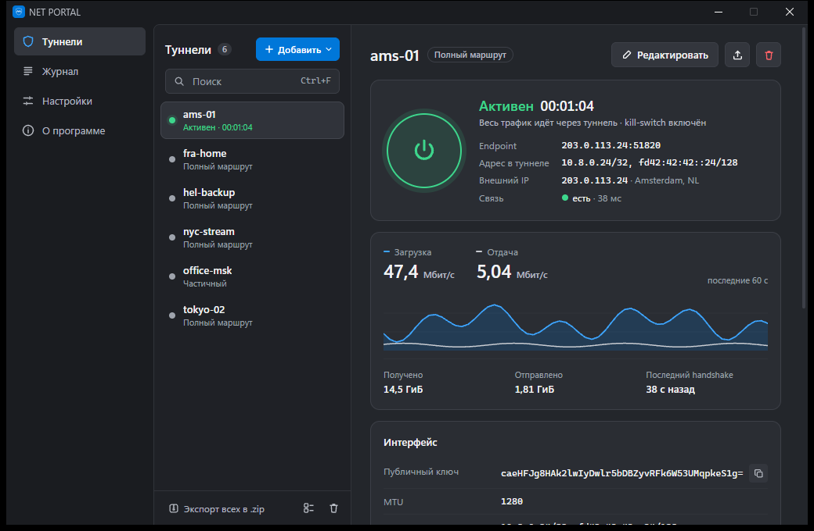
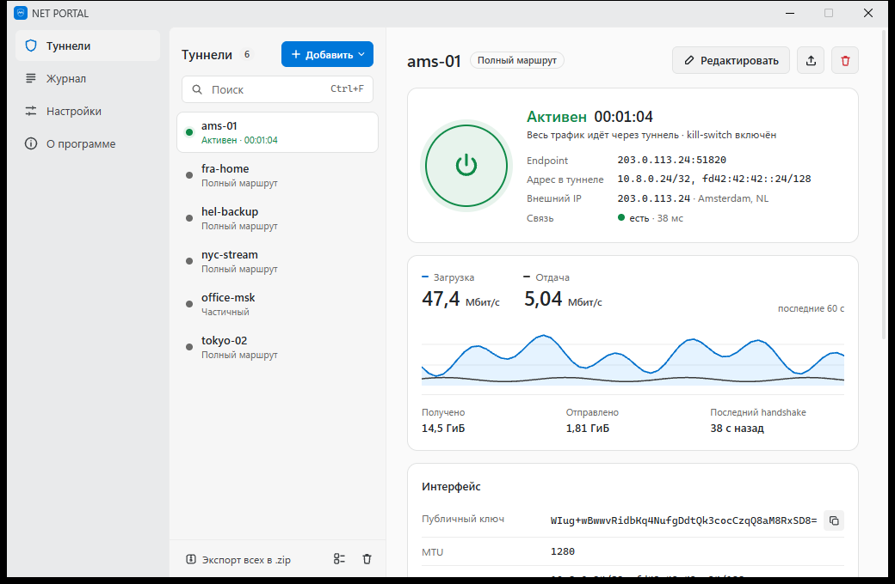
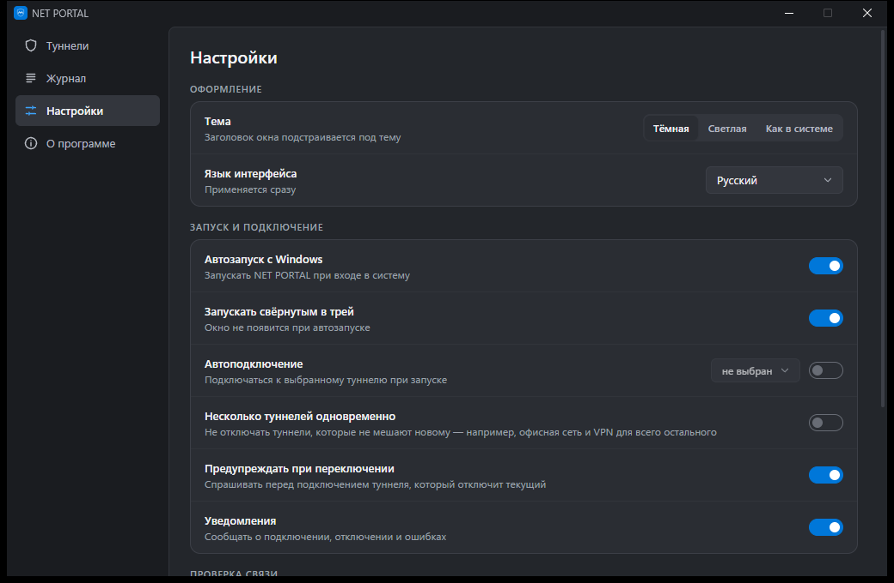

# NET PORTAL

VPN-клиент для Windows с обфускацией трафика. Основан на [AmneziaWG для Windows](https://github.com/amnezia-vpn/amneziawg-windows-client), который в свою очередь основан на [WireGuard для Windows](https://git.zx2c4.com/wireguard-windows/).



<table>
  <tr>
    <td></td>
    <td></td>
  </tr>
  <tr>
    <td align="center">Светлая тема</td>
    <td align="center">Настройки</td>
  </tr>
</table>

<sub>Скриншоты сделаны в демо-режиме, адреса и ключи ненастоящие.</sub>

Отличия от AmneziaWG:

- новый интерфейс на WebView2 (`webui/`): тёмная и светлая тема, график скорости, внешний IP, редактор конфигурации с проверкой ошибок, импорт из файла, буфера обмена и QR-кода, трей-попап, русский и английский языки;
- собственные имена служб и папки данных (`NetPortalManager`, `C:\Program Files\NetPortal\Data`), поэтому NET PORTAL можно установить рядом с AmneziaWG;
- обновления из релизов этого репозитория.

## Установка

Скачайте `NetPortal-Setup-<версия>.exe` из [последнего релиза](https://github.com/ZipFileZ/netportal/releases/latest) и запустите. Установщик сам выберет версию для вашего компьютера (x64, x86 или ARM64), поставит программу в `C:\Program Files\NetPortal`, зарегистрирует службу и добавит ярлык в меню «Пуск». Удаление — через «Параметры → Приложения»; туннели при этом можно сохранить.

Нужна Windows 10/11 с [WebView2 Runtime](https://developer.microsoft.com/microsoft-edge/webview2/) (в Windows 11 он уже есть).

Без установщика: положите `netportal-<архитектура>-<версия>.exe` в постоянную папку как `netportal.exe` и запустите. Удаление в этом случае: `netportal.exe /uninstallmanagerservice` от имени администратора, затем удалите папку.

Посмотреть интерфейс без установки: `netportal.exe /uidemo` — демо-режим с ненастоящими туннелями, ничего не устанавливает.

## Сборка

```
build.bat
```

Скрипт скачивает Go и компилятор в `.deps` и собирает `amd64`, `x86` и `arm64`. Подробнее — [`docs/buildrun.md`](docs/buildrun.md).

Установщик: `setup\build.bat` (нужен [Inno Setup 6](https://jrsoftware.org/isinfo.php): `winget install JRSoftware.InnoSetup`) — результат в `setup\out`.

## Выпуск обновления

Программа раз в час проверяет `latest.sig` в последнем релизе, сверяет его подпись с ключом в [`updater/constants.go`](updater/constants.go), скачивает новый exe, проверяет хэш и заменяет себя, не разрывая туннели.

1. Увеличьте `Number` в [`version/version.go`](version/version.go).
2. `build.bat`, затем `setup\build.bat`
3. `go run ./cmd/np-release sign` — файлы (exe, установщик и `latest.sig`) появятся в `release\v<версия>`.
4. Создайте релиз с тегом `v<версия>` и загрузите туда все файлы из этой папки.

Секретный ключ подписи хранится вне репозитория (`%USERPROFILE%\.netportal\release.key`). Без него выпустить обновление нельзя.

## License

```text
Copyright (C) 2018-2022 WireGuard LLC. All Rights Reserved.

Permission is hereby granted, free of charge, to any person obtaining a
copy of this software and associated documentation files (the "Software"),
to deal in the Software without restriction, including without limitation
the rights to use, copy, modify, merge, publish, distribute, sublicense,
and/or sell copies of the Software, and to permit persons to whom the
Software is furnished to do so, subject to the following conditions:

The above copyright notice and this permission notice shall be included in
all copies or substantial portions of the Software.

THE SOFTWARE IS PROVIDED "AS IS", WITHOUT WARRANTY OF ANY KIND, EXPRESS OR
IMPLIED, INCLUDING BUT NOT LIMITED TO THE WARRANTIES OF MERCHANTABILITY,
FITNESS FOR A PARTICULAR PURPOSE AND NONINFRINGEMENT. IN NO EVENT SHALL THE
AUTHORS OR COPYRIGHT HOLDERS BE LIABLE FOR ANY CLAIM, DAMAGES OR OTHER
LIABILITY, WHETHER IN AN ACTION OF CONTRACT, TORT OR OTHERWISE, ARISING
FROM, OUT OF OR IN CONNECTION WITH THE SOFTWARE OR THE USE OR OTHER
DEALINGS IN THE SOFTWARE.
```
